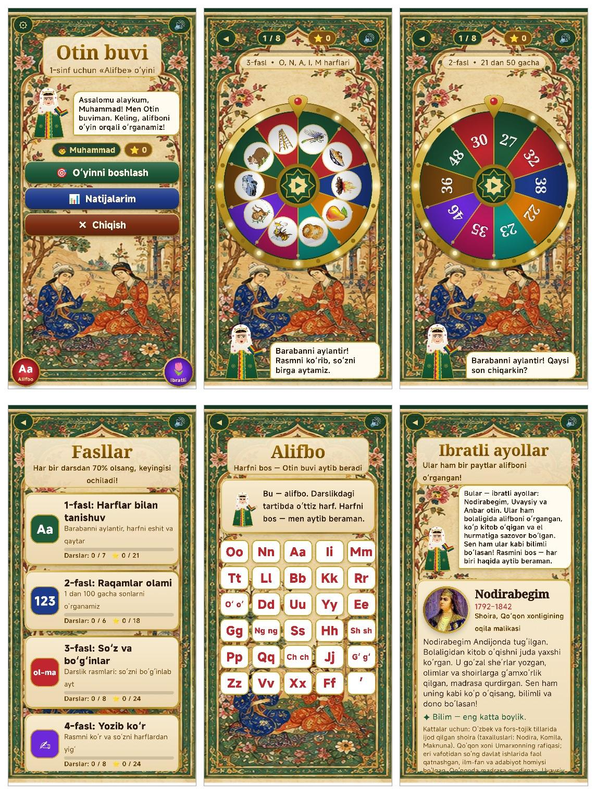

# 🔤 Otin buvi

**Savod o‘rgatish · Alifbo · 1-sinf (6–7 yosh) · Android · o‘zbek tilida**

Bolangiz alifboni o‘yin o‘ynab, ovoz chiqarib o‘rgansin — Otin buvi har bir harfni tinglab, baholab, maqtab boradi.

## Ilova haqida

«Otin buvi» — 1-sinf o‘quvchilariga o‘zbek alifbosini o‘yin orqali o‘rgatuvchi Android ilovasi. Harflar va 124 ta rasm amaldagi «Alifbe» darsligi tartibida berilgan, shuning uchun bola sinfda ko‘rgan so‘zlarni uyda xuddi shu ketma-ketlikda takrorlaydi. Bola sharqona barabanni aylantiradi, Otin buvi harf yoki so‘zni aytib «Men bilan qaytar!» deydi, bola aytadi — ilova talaffuzni telefonning o‘zida, internetsiz baholaydi. Natijalar o‘qituvchining Google jadvaliga avtomatik yuboriladi.

## Imkoniyatlar

- 30 harf darslik tartibida, 6 guruhga bo‘lingan; darslikning 124 ta rasmi bo‘g‘inlari bilan
- O‘zbekcha nutqni tanish (Vosk) — internetsiz, ovoz telefondan tashqariga chiqmaydi
- Barmoq bilan harf yozish (treking) va 0–3 yulduz bilan baholash
- Moslashuvchan takrorlash: bola ko‘p adashgan harf va so‘zlar ko‘proq chiqadi
- O‘qituvchi monitoringi: natijalar QR kod orqali ulangan Google jadvalga tushadi
- «Ibratli ayollar»: Nodirabegim, Uvaysiy, Anbar otin haqida bolabop hikoyalar

## O‘yin ssenariysi

1. 1-fasl «Harflar bilan tanishuv» — eshit va qaytar
2. 2-fasl «Raqamlar olami» — 1 dan 100 gacha sonlar
3. 3-fasl «So‘z va bo‘g‘inlar» — bo‘g‘inlab eshitib, so‘zni aytish
4. 4-fasl «Yozib ko‘r» — rasmga qarab so‘zni harf taxtachalaridan yig‘ish

## 🏆 Natija

6 ta o‘zbek va xalqaro analog (Duolingo ABC, Khan Academy Kids, Lingokids va boshq.) bilan 12 mezon bo‘yicha qiyosiy tahlilda **60 balldan 50 ball — 1-o‘rin**.

## O‘rnatish

1. **[otin-buvi.apk](https://github.com/MSoqiy/otin-buvi/raw/main/apk/otin-buvi.apk)** faylini yuklab oling (APK papkasi — [apk/](https://github.com/MSoqiy/otin-buvi/tree/main/apk)).
2. Faylni oching; telefon so‘rasa, «Noma'lum manbalardan o‘rnatish»ga ruxsat bering.
3. «O‘rnatish»ni bosing.

## English

**Otin buvi** — Uzbek alphabet and literacy game for first-graders with offline speech recognition. Free, ad-free. Part of the «Ta'limiy o‘yinlar» collection by Mamasaidov M.A..

---

**Muallif:** Mamasaidov M.A. — Toshkent shahar Mirzo Ulug‘bek markazi o‘qituvchisi · Tetrasoft · ✉ soqiy65@gmail.com · 🌐 https://msoqiy.github.io · «[Ta'limiy o‘yinlar](https://msoqiy.github.io/oyinlar/)»

**Boshqa ilovalar:** [Donish bobo](https://github.com/MSoqiy/donish-bobo) · [Bayon AI](https://github.com/MSoqiy/bayon-ai) · [Tilbilgich En AI](https://github.com/MSoqiy/tilbilgich-en) · [Tilbilgich Fr AI](https://github.com/MSoqiy/tilbilgich-fr) · [Tilbilgich De AI](https://github.com/MSoqiy/tilbilgich-de) · [Tilbilgich Ar AI](https://github.com/MSoqiy/tilbilgich-ar) · [Aljabr](https://github.com/MSoqiy/aljabr) · [GeoSayyoh](https://github.com/MSoqiy/geosayyoh) · [So‘zla](https://github.com/MSoqiy/sozla)

Kalit so‘zlar: alifbo o‘rganish, savod o‘rgatish ilovasi, 1-sinf alifbe, harflarni o‘rganish, o‘zbek alifbosi bolalar uchun, bolalar uchun o‘yin, nutqni tanish, азбука для детей на узбекском, обучение грамоте 1 класс, o‘zbekcha ta'limiy o‘yin, android apk
